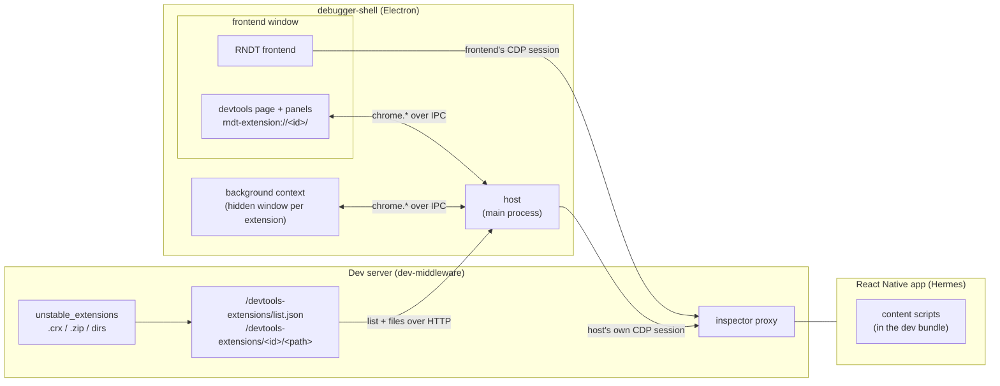
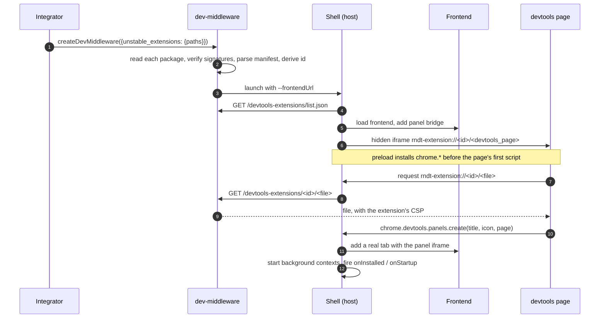
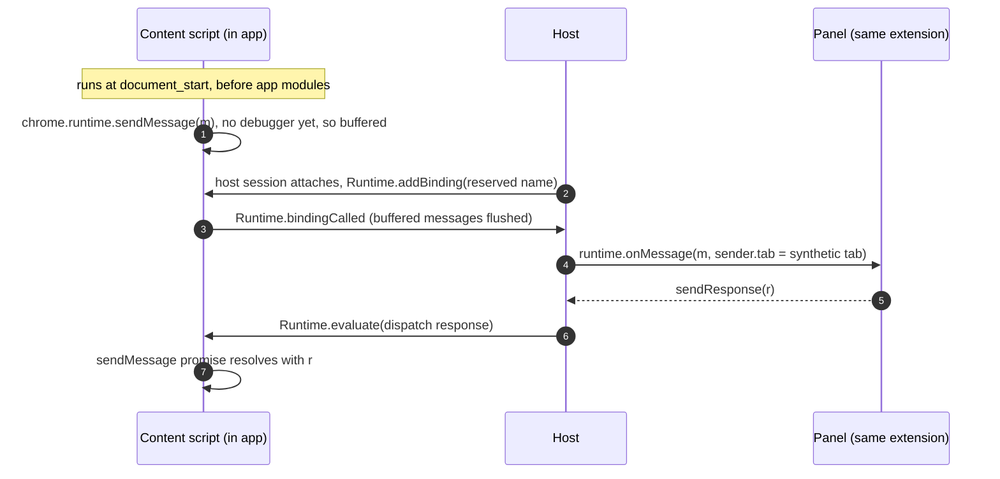

# RFC0000: Run unmodified Chrome DevTools extensions in React Native DevTools

> [!NOTE]
> This RFC follows up on the draft [RFC0978: 3P Extensions API for React Native DevTools panels](https://github.com/react-native-community/discussions-and-proposals/pull/979)
> by Alex Hunt, which was never implemented. It keeps RFC0978's guiding principle ("same API shape
> as Chrome") and adopts Expo's suggestion from its review of a served JSON extension list (§1.5).
> It replaces the rest: integrators point at extension packages, and the shell hosts them using
> Chrome's own injection model.
>
> The design comes out of a prototype,
> [V3RON/react-native-devtools-plugins](https://github.com/V3RON/react-native-devtools-plugins).
> [What the prototype proves](#what-the-prototype-proves) states, for each part of the design,
> whether it was observed on a device, verified in Electron, or is only designed.

## Summary

React Native DevTools (RNDT) ships an Electron shell, `@react-native/debugger-shell`. This RFC
proposes that the shell load Chrome DevTools extensions from `.crx` files, `.zip` files or
unpacked directories, and host them the way Chrome does:

- each extension gets its own origin;
- the `chrome.*` API is present before the extension's code runs;
- every `chrome.*` API that has a meaning in React Native is implemented, and the rest exist as
  inert shapes.

The goal is that an extension built for Chrome loads in RNDT **without modification**. The
prototype meets that goal for the five most-installed Chrome DevTools extensions for React
developers (React DevTools aside, which RNDT already ships): Redux DevTools, Apollo Client
Devtools, React Context DevTool, TanStack Query DevTools and Relay DevTools. Each runs from its
signed Chrome Web Store `.crx` against a React Native app. MobX DevTools, Altair and GraphQL
Network Inspector also load.

## Basic example

An integrator (Expo, the Community CLI, a framework) hands dev-middleware a list of extension
packages. Everything else (name, version, entry point, permissions) comes from each package's
`manifest.json`:

```js
createDevMiddleware({
  serverBaseUrl: 'http://localhost:8081',
  unstable_experiments: {enableDevToolsExtensions: true},
  unstable_extensions: {
    // Extension packages: .crx, .zip, or an unpacked directory. Illustrative paths.
    paths: [
      '/abs/path/to/redux-devtools.crx',
      '/abs/path/to/graphql-network-inspector.crx',
      '/abs/path/to/altair.zip',
      '/abs/path/to/mobx-devtools/',
    ],
  },
});
```

How the integrator finds these paths (autolinking, a config file, a folder of its own choosing)
is up to the integrator. React Native only loads what it is given.

The extension author writes **nothing RN-specific**. An excerpt of GraphQL Network Inspector's
Chrome Web Store manifest:

```json
{
  "manifest_version": 3,
  "name": "GraphQL Network Inspector",
  "version": "2.23.1",
  "devtools_page": "devtools/devtools.html",
  "background": { "service_worker": "background.js" },
  "permissions": ["webRequest", "storage"],
  "host_permissions": ["<all_urls>"]
}
```

Its pages call the ordinary Chrome API. The following is illustrative:

```js
chrome.devtools.panels.create('GraphQL', 'icon.png', 'panel.html');
chrome.devtools.network.onRequestFinished.addListener((request) => {
  request.getContent((body) => render(request, body));
});
```

## Motivation

React Native DevTools has no extension support. The ecosystem has worked around this in several
incompatible ways:

- [Rozenite](https://github.com/callstackincubator/rozenite) adds custom panels to RNDT through
  its own plugin framework.
- [Expo DevTools Plugins](https://docs.expo.dev/debugging/devtools-plugins/) open plugins as
  separate browser tabs.
- Many developers still reach for a second tool, such as a standalone Redux DevTools or a proxy.

Users ask repeatedly for Redux, MobX, Apollo and GraphQL tooling inside RNDT
([#819](https://github.com/react-native-community/discussions-and-proposals/discussions/819)).
Meanwhile, almost every one of those tools already exists as a **Chrome DevTools extension**,
because Chrome DevTools, which RNDT is built from, has had a stable extension API for over a
decade.

RFC0978 proposed a first-party extension API. This RFC addresses a narrower question: **what
should the extension contract be, so that the existing ecosystem comes along instead of being
rewritten?** Any solution should meet these constraints, whatever its design:

1. **No RN-specific forks of existing extensions.** Each extension that has to ship an "RNDT
   edition" is one that mostly won't. RFC0978's bootstrap snippet
   (`postMessage('requestExtensionAPI')` + `eval`) is small, but it still means the same files
   cannot run unchanged in both Chrome and RNDT.
2. **The extension package is the source of truth.** Chrome needs nothing but the package to
   install an extension. A config that repeats the name, entry page and manifest location next to
   the package duplicates data that can drift from it.
3. **Extensions must be testable in Chrome.** This only holds if the code is literally the same.
4. **Extensions do real work outside the panel.** All eight extensions the prototype runs need a
   background context, and six of them reach the app through content scripts. A panel-only subset
   (`panels.create` + `inspectedWindow.eval`) loads none of them.
5. **Unsupported APIs must degrade, not crash.** Extensions feature-detect by calling. A missing
   namespace (`chrome.alarms` is `undefined`) throws at module scope and kills the whole context.
   An inert namespace only loses that feature.
6. **Extensions must not get a more powerful foothold than in Chrome.** Third-party code in the
   debugger sits next to a live debugger session of the developer's app.

The expected outcome: the Chrome DevTools extension ecosystem becomes the React Native DevTools
extension ecosystem, except for the APIs that have no meaning without a browser.

## Detailed design

### Terminology

- **Shell**: `@react-native/debugger-shell`, the Electron app that hosts the RNDT frontend.
- **Host**: the extension-hosting code in the shell's main process.
- **Extension package**: a `.crx` file, a `.zip` file, or an unpacked directory with a
  `manifest.json` at its root.
- **Extension context**: any document belonging to an extension: the hidden devtools page, a
  panel page, an options page, or the background context.
- **DevTools context**: the devtools page and panel pages, the only contexts where Chrome exposes
  `chrome.devtools.*`.
- **Anchor**: the CDP domain, frontend panel or host surface a Chrome API needs to have its real
  effect. For example, `chrome.devtools.network` is anchored on the CDP `Network` domain that
  React Native implements. An API with **no anchor** cannot become real at any implementation
  effort (§4.3).
- **Inert shape**: an API that exists with Chrome's exact signature but has no effect: its events
  never fire and its methods return empty results.
- **Synthetic tab**: the one `tabs.Tab` that stands for the inspected app.
- **MAIN / ISOLATED world**: Chrome's two
  [content-script worlds](https://developer.chrome.com/docs/extensions/develop/concepts/content-scripts#isolated_world).
  In React Native, both are scopes inside the app's one JavaScript heap (§5.2).

### Packages affected

| Package | Change |
| --- | --- |
| `@react-native/dev-middleware` | the experiment, `unstable_extensions`, package loading and verification, the list endpoint and file serving (§1) |
| `@react-native/debugger-shell` | the `rndt-extension:` scheme, the extension preload, background and options windows, the `chrome.*` implementation, the CDP session for extensions (§2–§5) |
| `@react-native/debugger-frontend` | rendering extension panels as real tabs and reporting panel and theme events (§3.3) |
| `@react-native/metro-config` | emitting the configured extensions' content scripts into development bundles (§5.2) |

How the pieces fit together at runtime:



### 1. Configuration and discovery

#### 1.1 Feature flag

Everything sits behind a new dev-middleware experiment, `enableDevToolsExtensions`. It is off by
default. It requires `enableStandaloneFuseboxShell`, which is on by default, because extensions
are hosted by the shell (§3.4). With the flag off, no extension code is loaded and nothing
changes.

#### 1.2 `unstable_extensions`

```js
type ExtensionsConfig = Readonly<{
  /** Extension packages to load: .crx, .zip, or unpacked directories. */
  paths?: ReadonlyArray<string>,
}>;
```

That is the whole integrator surface. React Native does not search for extensions: there is no
default folder and no per-user location. **Discovery belongs to integrators.** Integrators only
say *where* a package is. They never describe it; that is the manifest's job. There is no
separate switch for content scripts: they run because the package is listed, as Chrome runs what
an installed manifest declares (§5.2). The same object is passed to the Metro helper in §5.2, so
the bundler and the dev server agree on what is enabled.

#### 1.3 Loading and verifying a package

Unpacked directories are used in place. `.crx` (CRX3) and `.zip` files are **read in place, never
unpacked**, and hostile archive entries are refused. The archive rules are in §5.10 of the prototype's
[porting spec](https://github.com/V3RON/react-native-devtools-plugins/blob/main/docs/SPEC-DEBUGGER-SHELL-EXTENSIONS.md).

Verification does what Chrome does, using Chrome's own formats: Chromium's
[CRX3 format](https://source.chromium.org/chromium/chromium/src/+/main:components/crx_file/crx3.proto)
and [verifier](https://source.chromium.org/chromium/chromium/src/+/main:components/crx_file/crx_verifier.cc),
and its [content verification](https://source.chromium.org/chromium/chromium/src/+/main:extensions/browser/verified_contents.cc)
for unpacked Web Store builds.

- **`.crx`:** checked as Chromium's verifier checks it. A package signed by the Chrome Web Store is
  reported as *Chrome Web Store*; any other validly signed package is *self-signed*.
- **Unpacked or `.zip` with `_metadata/verified_contents.json`:** checked as Chrome's content
  verification checks it, and reported as *Chrome Web Store*.
- **No signature:** the package loads and is reported as *unsigned*. This is normal for local
  development.

A package that fails verification is refused with an error naming it and the check that failed.
Other extensions still load.

**What verification is for.** It catches corrupt, truncated or modified-after-signing packages,
and it tells the developer where a package came from. It is **not** a defence against an attacker
who can write to the configured path: that attacker can re-sign the package or strip its
signature, and it then loads as self-signed or unsigned. The trust decision is made by whoever
puts a path into `unstable_extensions`. A Web Store proof is not required, because that would
rule out private and in-house extensions.

#### 1.4 Extension ids

Chrome derives an extension's id from its public key
([`key`](https://developer.chrome.com/docs/extensions/reference/manifest/key)), and some
extensions depend on that (for example, a hardcoded id). The id is the first source that applies, in this order:

1. the `.crx` signing key;
2. the manifest's `key` field;
3. the signed `item_id` in `verified_contents.json`;
4. otherwise, a hash of the configured path, as Chrome does for unpacked extensions.

The first three give the extension the same id in Chrome and in RNDT. Packages are read in place,
so the configured path is the package's real location: a `.zip` or folder keeps its id, and so its
storage, when its contents change.

#### 1.5 Manifest, list and files

dev-middleware parses each manifest, expands `__MSG_*__` strings, and serves two endpoints under
its `serverBaseUrl`:

- `GET /devtools-extensions/list.json`: one entry per extension with its id, version, provenance
  and parsed manifest. It contains **no filesystem paths**.
- `GET /devtools-extensions/<id>/<path>`: the extension's files, served with the same realpath
  containment as §2.

The shell derives the list URL from the server in the `frontendUrl` it is launched with, so it
works when the dev server runs on another machine. The shell's `rndt-extension:` handler fetches
from these endpoints, so the shell never reads the dev server's filesystem.

Supported manifest fields: `manifest_version` (3), `name`, `version`, `devtools_page`,
`background` (`service_worker` or `scripts`), `content_scripts`, `permissions`,
`host_permissions`, `web_accessible_resources`, `options_ui`/`options_page`, `default_locale`,
`content_security_policy`, `commands` and `key`. Any other field is ignored with a console
warning: rejecting a store manifest over one unused field would break
constraint 1. Manifest V2 is not supported; Chrome no longer runs it either. A package with
neither a `devtools_page` nor a `background` is skipped with a warning.

From a configured path to a panel tab:



### 2. Hosting: one origin per extension

The shell registers a privileged custom scheme and gives each extension its own origin:

```
rndt-extension://<extension-id>/<path>
```

- **Per-extension origin.** Chrome gives every extension its own origin, and extensions rely on
  it: `chrome.runtime.getURL`, relative paths in `panels.create`, `storage` scoping, and
  `postMessage` origin checks. With a shared origin, Expo's prototype for RFC0978 had to resolve
  relative `panels.create` paths by hand. A per-extension origin makes that unnecessary.
- **Cross-extension reads.** A custom scheme does not stop extension A from fetching extension B's
  files; the prototype measured exactly this. Following Chrome, the handler refuses a request from
  another extension's frame unless the path is listed in the target's
  [`web_accessible_resources`](https://developer.chrome.com/docs/extensions/reference/manifest/web-accessible-resources).
- **CSP.** Every response carries the extension's
  [`content_security_policy`](https://developer.chrome.com/docs/extensions/reference/manifest/content-security-policy), or Chrome's MV3
  default. An extension that declares a weaker policy is refused at load, as Chrome refuses to
  install it.
- **Storage scope.** Storage is keyed by extension id in the shell, shared across projects, like a
  Chrome profile. If two dev servers offer the same id with different contents at the same time,
  the shell keeps the first and refuses the second, naming both (see Unresolved questions).

### 3. API injection: preload, not handshake

#### 3.1 Mechanism

The shell registers its extension preload on the session
(`session.registerPreloadScript({type: 'frame'})`), so the window's own `webPreferences.preload`
is left unchanged. It also enables `nodeIntegrationInSubFrames`, so that the preload runs in every
frame, including extension iframes inside the frontend. The preload checks the frame's protocol. For an
`rndt-extension:` document, it builds the `chrome` namespace and exposes it through `contextBridge`
**before any of the extension's scripts run**. This is the shell's equivalent of the way Chrome
injects its API into extension frames.

The window stays sandboxed: `sandbox: true`, `contextIsolation: true`, `nodeIntegration: false`,
`webSecurity: true`. The preload is shipped as one bundled file, because a sandboxed preload
cannot `require` modules. Despite its name, `nodeIntegrationInSubFrames` only controls *whether
the preload runs in subframes*; it gives pages no Node. The preload exposes named, validated IPC
channels only. IPC handlers are installed on each `WebContents` the host owns, never on the
global `ipcMain`.

#### 3.2 Identity is derived

Every IPC call is attributed in the main process from the calling frame (`event.senderFrame`,
pinned to the principal that registered it). The extension id comes from the frame's own URL,
never from the payload. Permission checks use the manifest the shell loaded, so a page that
overrides `chrome.runtime.getManifest` cannot widen its grants. `chrome.devtools.*` is honoured
**only from DevTools contexts**, as in Chrome. A background or options page that calls
`inspectedWindow.eval` gets Chrome's error.

#### 3.3 Execution contexts

| Context | Where it runs |
| --- | --- |
| devtools page (hidden), panel pages | iframes in the frontend; each panel is a real frontend tab, and `onShown(window)`/`onHidden` fire on selection |
| background context | the main frame of a hidden window, one per extension; it survives frontend reloads, and `runtime.onInstalled` / `onStartup` fire from a recorded install state |
| options page | its own window |
| content scripts | inside the inspected app (§5.2) |

Every extension context gets the same preload and policy. Extension windows refuse to navigate
away from their own `rndt-extension://<id>/` origin and cannot open further windows. A document
that navigated away would otherwise get the preload of whatever it landed on.

The shell's user agent has no `Electron/` token, because extensions branch on it (Redux DevTools
takes an "Electron port" code path).

#### 3.4 Shell only: no browser hosting

**Extensions are supported only in the standalone shell.** When RNDT is opened in a browser, no
extension is loaded, and enabling the extensions experiment with the shell experiment off is an
error.

The shell's README says features are added to it only "if they are strictly necessary to
complement the DevTools frontend's built-in capabilities". Extension hosting meets that bar. The
frontend cannot do any of the following by itself:

- inject an API before a frame's first script runs;
- give each extension its own origin;
- run a background context that survives a frontend reload.

All three need control of the host. A browser fallback would need the bootstrap snippet this RFC
rejects (constraint 1), so the same extension would behave differently depending on where RNDT
was opened.

### 4. API surface

#### 4.1 The stubbing rule

Every `chrome.*` namespace that Chrome exposes to a DevTools extension **exists**. Each one is
real, partial or inert, and none is `undefined`. Inert namespaces keep Chrome's exact shape, including
its promise and callback forms, [`runtime.lastError`](https://developer.chrome.com/docs/extensions/reference/api/runtime#property-lastError)
and [`Event` objects](https://developer.chrome.com/docs/extensions/reference/api/events). This is what makes constraint 5 hold.
Real extensions depend on it at startup: Redux DevTools' worker iterates `commands.getAll()` as
Chrome's `Command[]` and registers `runtime.onConnectExternal`, and threw in the prototype until
those shapes existed.

#### 4.2 Tiers

The tiers describe **how much a feature matters to extensions**, not the order in which features
ship. Tier 1 and Tier 2 ship together (Adoption strategy).

**Tier 1: no extension works without these.**

| API | RN mapping |
| --- | --- |
| `devtools.panels.create`, `Panel.onShown/onHidden`, `themeName`, `setThemeChangeHandler` | real frontend tabs; the theme follows RNDT's |
| `devtools.inspectedWindow.eval` / `.reload` / `.tabId` | CDP `Runtime.evaluate` / `Page.reload` (§5.1), with Chrome's `[result, exceptionInfo]` mapping; results are JSON values only |
| `devtools.network.onRequestFinished`, `getHAR`, `Request.getContent` | a host-side model built from CDP `Network.*` events, HAR 1.2, lazy `Network.getResponseBody` |
| `runtime` (`id`, `getURL`, `getManifest`, `sendMessage`, `connect`/Ports, `onMessage`, `onInstalled`, `onStartup`) | a host-side message router between the contexts of one extension, with Chrome's rules for settling responses; as in Chrome, content scripts are not `runtime` peers and are reached only through `tabs` |
| `storage.local` / `sync` / `session`, `storage.onChanged` | one host-owned store per extension, with change events sent to all its contexts |
| `i18n.getMessage`, `__MSG_*__` in manifest and CSS | real, from `_locales`, following the shell's UI locale |

**Tier 2: many real extensions do not start without these.**

| API | RN mapping |
| --- | --- |
| background `service_worker` / `scripts` (classic and ES module) | a hidden, always-on context (§3.3) |
| `content_scripts`, `scripting.executeScript` | run inside the app (§5.2) |
| `webRequest` (observe only) | the same network model as `devtools.network` |
| `tabs` | the synthetic tab; `tabs.sendMessage` reaches content scripts |
| `permissions` | reports what the manifest grants; `request` grants nothing new |
| `alarms`, `notifications`, `downloads` | timers, native notifications, the shell's save dialog |
| `options_ui` | a separate window |
| `commands` | `getAll` from the manifest; `onCommand` routed through the app menu |
| [`debugger`](https://developer.chrome.com/docs/extensions/reference/api/debugger) | a CDP session of each attached extension's own (§5.1); commands and the app's answers are forwarded unchanged |

Extension pages may also use ordinary web APIs within their CSP, including `fetch` and `WebSocket`
to the dev server. Plugins that talk to the app through a WebSocket relay, as Expo DevTools
Plugins do today, keep working unchanged. The documented contract for reaching the app is still
CDP (`inspectedWindow.eval`, content scripts).

**Tier 3: inert for now.** `webNavigation`, `identity`, `offscreen` and `devtools.recorder` have
anchors that could be built later, but nothing needs them yet. The APIs that can never be real
are in §4.3.

#### 4.3 The anchor list: what can never be real

Chrome's APIs attach to panels and browser surfaces. RNDT ships a smaller, closed set of those. Most
importantly, it has **no Elements panel**: there is no DOM, and jsinspector-modern implements no
`DOM`/`Overlay` domains. The APIs below are out of reach by construction, not by effort, so they
keep inert shapes permanently:

| Missing anchor | APIs |
| --- | --- |
| Elements panel / selected node | `panels.elements.*` (incl. `createSidebarPane`), `inspectedWindow.getSelectedNode` |
| A page / document | DOM manipulation in content scripts (`css`, URL `matches` against a page), `scripting.insertCSS` |
| Browser UI | `action` popups/`onClicked`, `contextMenus.onClicked`, `sidePanel.open`, tab lifecycle events, `captureVisibleTab`, `chrome.windows` behaviour |
| CDP `Fetch` domain | blocking `webRequest`, `declarativeNetRequest` |

The React Components panel is **not** a substitute for Elements. It shows React's own tree and has
no `RemoteObjectId` for "the selected node". Mapping element sidebars onto it would be a new
product feature, not Chrome compatibility, so it is out of scope.

### 5. The inspected app

#### 5.1 A debugger session for extensions

With the standalone shell enabled, dev-middleware's inspector proxy already lets several debuggers
connect to one target, provided the target advertises `supportsMultipleDebuggers`. jsinspector-modern
does advertise it. The shell uses this: it opens **its own CDP session** to the inspector URL in
the `ws=` of its `frontendUrl`, next to the frontend's session, and sends everything it does for
extensions over it:

- `Runtime.evaluate` for `inspectedWindow.eval`;
- `Network.enable` and `Network.getResponseBody` for the network model;
- `Runtime.addBinding` for content scripts.

The frontend's session is not touched, and the shell does not pick a target. Events caused by
extensions, such as `Runtime.bindingCalled`, reach only the session that asked for them: bindings
and `Network.*` events are scoped per session in jsinspector-modern. The shell listens on no
socket. The session survives frontend reloads; on reconnect, its consumers re-enable `Network`
and re-add their bindings.

Each extension that calls `chrome.debugger.attach` gets **a further session of its own**, so its
raw CDP traffic never mixes with the host's or the frontend's.

The host writes characters outside the BMP as `\uXXXX` escape pairs in every evaluate, because
Hermes refuses to compile them in `Runtime.evaluate` source; one emoji in a Relay record used to
drop every message that carried it (Unresolved questions).

Before dialling, the shell reads the target's capability from `/json/list`. If the target does
**not** support multiple debuggers, the shell does not connect, because connecting would evict
the frontend. CDP-backed APIs then fail with that reason, while panels, storage and messaging keep
working. A single relayed session could close this gap (Unresolved questions).

#### 5.2 Content scripts

DevTools extensions use content scripts as a **bridge**, not to manipulate a DOM. They hook a
global (`__REDUX_DEVTOOLS_EXTENSION__`, `__RELAY_DEVTOOLS_HOOK__`,
`__MOBX_DEVTOOLS_GLOBAL_HOOK__`) and relay messages to the background. This works in Hermes.

**On by default, as in Chrome.** Every configured extension's `content_scripts` run as its
manifest declares, and `chrome.scripting.executeScript` needs the `scripting` permission, as in
Chrome. There is no second opt-in, because it would protect nothing: whoever lists a package
already trusts it with the developer's debugger session (§1.3), and its devtools page can already
run code in the app through `inspectedWindow.eval`. It would also break most of the extensions
people want: six of the eight the prototype runs depend on content scripts. What bounds them
instead:

- they are emitted into **development bundles only**, never a release build;
- each runs in its extension's own scope (below), and nothing is set on the app's global;
- `matches` patterns are reported but cannot target anything, because an RN target has no URL.
  Every script runs in every app the dev server builds.

To keep an extension's code out of the app, the integrator does not configure that extension.

**When they run.** Chrome runs a content script at the point its
[`run_at`](https://developer.chrome.com/docs/extensions/develop/concepts/content-scripts#run_time) declares, on every page load. React
Native has no document lifecycle, but it has the same two moments, and the bundle is where to hit
them:

| `run_at` | RN equivalent | Emitted as |
| --- | --- | --- |
| `document_start` | before any app module, including React Native's own setup | a serializer polyfill |
| `document_end`, `document_idle` | after the entry module has run | code after the main module call |

Because the scripts are part of the bundle, they run again on every reload, which matches Chrome's
injection on every page load. This is required. Several libraries look up their
hook **only once, while they load**, so a script injected when the debugger attaches is always
too late:

- Redux's `configureStore` reads `__REDUX_DEVTOOLS_EXTENSION_COMPOSE__` when the store is
  created;
- `relay-runtime` registers each `Environment` with `__RELAY_DEVTOOLS_HOOK__` from its
  constructor;
- `mobx` calls `__MOBX_DEVTOOLS_GLOBAL_HOOK__` when it loads.

A `<script src=chrome.runtime.getURL(f)>` appended by an early script (Relay and React Context
DevTool load their hooks this way) runs synchronously in the extension's MAIN-world scope when
the bundle contains that file; which files to emit is open (Unresolved questions).

**Integration point.** A helper in `@react-native/metro-config`,
`withDevToolsExtensions(metroConfig, extensionsConfig)`, takes the same config object as §1.2 and
adds the scripts and their loader to development bundles only. For other bundlers, the same
package exports the generated sources (`getDevToolsExtensionPreludes`).

**`chrome.runtime` inside the app.** The loader gives ISOLATED-world scripts `sendMessage`
and `connect`; MAIN-world scripts get no `chrome`, as in Chrome.

- App→host traffic uses `Runtime.addBinding` / `Runtime.bindingCalled`, and host→app traffic uses
  `Runtime.evaluate`.
- Messages sent before the debugger attaches are held in a **bounded** buffer and sent when the
  binding appears.
- `sender.tab` is the synthetic tab, so extensions that key their ports on `sender.tab.id` work.

A content script talking to its extension's panel, including a message sent before RNDT is open:



**A per-extension scope.** Chrome's worlds talk through `window.postMessage`, but Hermes has
neither that API nor isolated worlds. The loader therefore runs every script (bundle-emitted or
`executeScript`) in a per-extension scope, where `window`, `self` and `globalThis` are a proxy
over the real global and `chrome` is that extension's own API. The scope supplies what real
content scripts use and React Native lacks: browser shims (`document`, `location`, `navigator`,
the `Event` family, `MessageChannel`), a trusted MAIN↔ISOLATED `postMessage` bus that carries
ports and keeps messages posted before the ISOLATED world exists, and `chrome.storage`.
`inspectedWindow.eval` also runs in the calling extension's MAIN-world scope, so a panel's
`window.postMessage(…)` reaches its own content script, as Relay DevTools expects. The full list
is in §5.11 of the porting spec.

The scope keeps one extension's names and traffic away from other extensions and from the app. It
is **not a security boundary**: all scripts share the app's heap.

`scripting.executeScript` keeps Chrome's on-demand semantics. It is evaluated over CDP when called.

### 6. Security model

| Concern | Mechanism |
| --- | --- |
| Page world reaching Node | `sandbox`, `contextIsolation`, `nodeIntegration: false`, one bundled preload, named channels only |
| Extension impersonating another | identity from the calling frame's URL, pinned at registration |
| Reading another extension's files | origin check against `web_accessible_resources` (§2) |
| Permission escalation | grants from the loaded manifest; deliveries filtered by declared permissions; `chrome.devtools.*` only from DevTools contexts |
| Escaping an extension window | navigation and window-open guards on every extension window (§3.3) |
| Code from elsewhere | per-extension CSP; extensions with weaker policies refused |
| Corrupt or modified packages | CRX3 and `verified_contents.json` verification (§1.3); not a defence against whoever controls the configured path |
| Hostile archives | in-place reading with size and CRC checks; encrypted, ZIP64, symlink and non-relative entries refused |
| Filesystem escape | realpath containment of every served file; no paths sent to the shell |
| Debugger session | the host's own CDP sessions (§5.1); no listening socket; never connects when that would evict the frontend |
| Code in the app | only configured extensions, development bundles only, per-extension scope; nothing set on the app's global |

## What the prototype proves

A part of the design counts as verified only once it has run. Each part is in one of four states.
The prototype's test suite has 719 passing tests, including real-Electron suites.

**The React-ecosystem run.** On 2026-11-24, the five extensions from the Summary ran unmodified
against an Expo SDK 58 / React Native 0.88.1 app on the iOS simulator, each from its Chrome Web
Store `.crx`. The
[evidence](https://github.com/V3RON/react-native-devtools-plugins/blob/main/docs/evidence/react-ecosystem-extensions/README.md)
has 21 screenshots, a table for each feature, and the host change each extension needed. A
panel action counts as reaching the app only when it was read back from the app's own UI or
store.

| Extension | Users¹ | Result |
| --- | --- | --- |
| Redux DevTools 3.2.12 | 1,000,000 | ✅ both directions: actions, diffs, trace, chart, RTK Query; jump, skip, dispatch, lock, export/import |
| Apollo Client Devtools 4.26.8 | 200,000 | ✅ queries, mutations, cache, memoization; Explorer runs queries through the app's own client |
| React Context DevTool 4.4 | 30,000 | ✅ contexts, reducers, diff; dispatching from the panel |
| TanStack Query DevTools 1.1.0 | 10,000 | ✅ both directions: forcing loading and error states, invalidate, reset, remove, editing data |
| Relay DevTools 0.9.17 | 5,000 | ✅ app → panel: store, network, optimistic updates, event log. ❌ panel → app, because of a bug in the extension: its frontend calls `_wall.sendAll`, which does not exist. It fails the same way in Chrome. |

¹ chrome-stats.com, 2026-11-24.

**Not yet exercised:** Android, physical devices, toolbar popups (the host has no toolbar),
Apollo cache editing, Redux remote DevTools and state persisted across reloads, Relay environment
switching, and the shell's native download dialog.

| State | Parts |
| --- | --- |
| **Observed on a device** (iOS simulator) | <ul><li>the run above, plus MobX DevTools</li><li>Web Store `.crx` files loaded with their signatures checked</li><li>the host's own CDP session next to the frontend's on a real app</li><li>`inspectedWindow.eval`</li><li>content scripts over CDP, with `chrome.storage`, `tabs.sendMessage` round trips and app→host messages over `Runtime.bindingCalled`</li><li>the per-extension scope, its browser shims and its trusted bus with ports</li><li>MAIN-world `document_start` hooks run before any app module, through a Metro polyfill generated from the manifests</li><li>escaping characters outside the BMP</li></ul> |
| **Verified in Electron** (headless tests in a real Electron process) | <ul><li>the custom scheme, with containment and per-extension CSP</li><li>the session-registered preload with `sandbox: true` for every frame class, and IPC per `WebContents`</li><li>panels as tabs, background contexts (including GraphQL Network Inspector's and Altair's), messaging, `storage`, `i18n`</li><li>signed CRX3 files read in place: Chromium's proof check, the key-derived id, refused tampering and hostile entries</li><li>`chrome.debugger` and the host's own CDP session, against a fake inspector proxy</li><li>a "kitchen sink" extension running the same build in Chrome and the shell</li></ul> |
| **Implemented, not walked on a device** | `devtools.network` / `webRequest` against a real app's traffic; per-session scoping of `Network.*` events and bindings (read from jsinspector-modern's source, not tested separately) |
| **Designed only** | <ul><li>standalone `.zip` packages, the Web Store proof and `verified_contents.json` checks (§1.3)</li><li>ids from the manifest `key`, `item_id` or a path hash; the prototype uses the folder name for directories (§1.4)</li><li>dev-middleware config, list and file endpoints; the prototype scans one folder (§1.5)</li><li>the `web_accessible_resources` origin check (§2)</li><li>`chrome.devtools.*` gated to DevTools contexts (§3.2)</li><li>navigation guards on worker windows (§3.3)</li><li>inert shapes for every namespace; the prototype still leaves `windows`, `identity`, `offscreen` and `declarativeNetRequest` undefined (§4.1)</li><li>`commands.onCommand`</li><li>content scripts on by default; the prototype still gates them behind an opt-in</li><li>ISOLATED-world and `document_end`/`document_idle` scripts in the bundle, the Metro helper as a package, and the buffer before attach (§5.2); the prototype injects ISOLATED scripts when its session attaches</li><li>the compatibility checker</li></ul> |

The prototype also depends on a patched RNDT frontend that renders extension panels. Upstream would
need the same change in `@react-native/debugger-frontend`. The host is split from the prototype's
own shell behind one entry module; how it would move into `@react-native/debugger-shell` is in the
[porting spec](https://github.com/V3RON/react-native-devtools-plugins/blob/main/docs/SPEC-DEBUGGER-SHELL-EXTENSIONS.md).

## Drawbacks

- **Cost.** The prototype's host is about 14,000 lines of JavaScript, most of it the
  `chrome.*` implementation. The upstream shell is about 600 lines today, and RFC0978 proposed two
  methods. The change touches four packages and the frontend, and the React Native DevTools
  maintainers would own an API surface that tracks Chrome's semantics. Mitigation: the API shapes
  can be generated from Chrome's type definitions, and the "kitchen sink" extension can serve as a
  conformance test in both Chrome and the shell.
- **Shell only.** Developers who open RNDT in a browser get no extensions (§3.4).
- **Electron dependencies.** The design depends on `nodeIntegrationInSubFrames`, which Electron
  marks experimental (Expo raised this in RFC0978's review); the fallback is HTML injection
  (Alternatives). Keeping `sandbox: true` also means shipping the preload as one bundled file, a
  new build step for a package built per file with Babel (Unresolved questions).
- **Private frontend internals.** Panels are added through the frontend's `InspectorView` and
  `SimpleView`. These are internals the devtools-frontend team never promised to keep stable, so a
  frontend refactor can break panels without any failure at build time.
- **Fidelity gaps.** Network extensions see what RN's network inspection reports. Traffic from
  native modules or custom transports may never reach CDP, so an extension that works in Chrome
  may show an empty list here. We print a console line instead of inventing data, but this will
  still generate issues.
- **Extension bugs will be reported as RNDT bugs**, as Relay DevTools' panel → app failure would be.
  Triage needs a quick way to check the same build in Chrome.
- **Browser assumptions.** The scope shims only what real extensions were seen to use; an extension
  that reaches for more fails until the shims grow.
- **Divergences from Chrome:**
  - the background context is never evicted, unlike Chrome's
    [service worker lifecycle](https://developer.chrome.com/docs/extensions/develop/concepts/service-workers/lifecycle), so `onSuspend`
    and `onUpdateAvailable` never fire;
  - alarms do not persist;
  - there is one tab, and `tabs.create` opens nothing by default;
  - options pages open in a window;
  - content scripts share the app's heap and cannot message other extensions;
  - functions crossing `contextBridge` print as `[native code]`.

  Each is documented, but an extension could depend on any of them.
- **Content scripts change the bundle and run without a debugger.** Every configured extension's
  scripts are part of every development bundle, so their hooks are installed even when RNDT is
  not open, and a broken content script affects the app's development build. The bundler also has
  to know the extension list.
- **No CDP for older apps** without `supportsMultipleDebuggers` (§5.1).
- **A pinned Web Store key.** Reporting *Chrome Web Store* provenance means shipping the store's
  public key, as Chrome does. If Google rotates it, that label is wrong until React Native ships the
  new key. The integrity checks do not depend on the key.
- **Security exposure.** Background code and code in the app have more power than a sandboxed
  panel; §6 bounds it.

## Alternatives

- **RFC0978 as drafted** (descriptor config, panel subset, `postMessage` handshake). It is cheaper
  and works in a browser too. It fails constraints 1, 2 and 4: every extension needs an RN edition,
  its metadata is repeated outside the package in config, and none of the extensions the prototype
  runs loads.
- **Inject by rewriting HTML** (`protocol.handle` inserting a `<script>` into `<head>`). Expo
  prototyped this. It avoids `nodeIntegrationInSubFrames`, but it edits third-party HTML as strings,
  misses documents the extension creates itself, and still needs a way to pass host APIs to the
  page. We keep it as the fallback if `nodeIntegrationInSubFrames` changes.
- **Electron's built-in `session.loadExtension`.** Electron supports only a small part of the
  extension API, and only for browser-like targets. It has no `chrome.devtools` for a custom
  frontend and no way to map `inspectedWindow`/`network` onto an RN target.
- **Implement `chrome.devtools.*` in the frontend.** Chrome DevTools' own frontend implements this
  API. The shell would still be needed for injection, origins, background contexts and the rest of
  `chrome.*`, so this splits one implementation across two places.
- **Sit between the frontend and the app.** The prototype's first design relayed the frontend's
  session through a listening socket and leaked extension-caused events into the frontend. An
  embedder-transport relay without the socket is an open question.
- **Reuse the frontend's session through its SDK**, as Chrome's own `ExtensionServer` does. It is
  viable, but the session would only live as long as the frontend page, and it depends on more
  private internals.
- **Content scripts behind a per-extension opt-in, or injected only when the debugger attaches.**
  The prototype started with both. The opt-in adds no protection (§5.2), and late injection misses
  every hook a library looks up as it loads.
- **A custom RN plugin protocol.** This loses the existing ecosystem.
- **Do nothing.** Rozenite and Expo DevTools Plugins keep diverging.

## Adoption strategy

The change is additive and non-breaking: nothing changes unless the experiment is enabled. RFC0978
was never implemented, so there is no earlier API to stay compatible with.

1. **Ship behind `enableDevToolsExtensions`** as one unit: hosting, injection, Tier 1 **and** Tier 2.
   A Tier-1-only release would load none of the extensions people want (constraint 4).
2. **Early adopters test it.** Integrators wire discovery and the Metro helper behind the flag: Expo
   from autolinking, the Community CLI from its own config, frameworks from their own conventions.
   Existing Expo DevTools Plugins and Rozenite plugins that are web pages become extensions with a
   short `manifest.json` and `devtools.html`.
3. **Harden from that feedback**, and run conformance against a pinned set of store extensions.
   The starting point is the eight the prototype runs, with Android and physical devices added
   to the matrix.
4. **Roll out.** Turn the experiment on by default, then drop `unstable_` once the conformance
   suite passes on every release.

No codemod is needed: no app code has to change.

## How we teach this

The message is "**Chrome DevTools extensions, minus what needs a browser**". The documentation
links to Chrome's [DevTools extension docs](https://developer.chrome.com/docs/extensions/how-to/devtools/extend-devtools) and the
[API reference](https://developer.chrome.com/docs/extensions/reference/api), and adds one RN page with:

- the anchor list (§4.3) as a single table, so developers know up front what can't work and why;
- a "will my extension work?" ladder, from most to least likely:
  1. UI-only panels using `storage` and `runtime`;
  2. `inspectedWindow.eval` state inspectors;
  3. network inspectors, which see whatever traffic reaches CDP;
  4. content-script bridges, which work when the library looks up its hook the way §5.2 expects;
  5. browser-controlling extensions (blockers, scrapers), which won't work;
- where to install an extension: a pointer to each integrator's documentation;
- how to test: run the same build in Chrome and in RNDT.

"Synthetic tab" belongs in reference docs only.

**A compatibility checker.** The tier table and the anchor list are data, so compatibility can be
checked mechanically:

```sh
npx @react-native/devtools-extensions check ./graphql-network-inspector.crx
```

The checker:

- runs the package verification from §1.3;
- reads the manifest and scans the scripts for `chrome.*` usage;
- reports each API as **works**, **degrades** (inert shape) or **never works** (no anchor), with
  the reason;
- lists the code it will run inside the app (content scripts and `executeScript` calls).

Static analysis of minified code is best-effort, and the report says so. The same data ships as an
**agent skill**, so an AI agent can answer "will this extension work in RN DevTools?" itself.

## Unresolved questions

- **Bundling the preload:** add an esbuild/rollup step for one file to React Native's build, or
  check in a generated file?
- **A supported panel hook:** can the devtools-frontend team expose a supported way to add a panel
  and read the theme, instead of `InspectorView` internals?
- **Same id from two dev servers:** is "first wins, second refused" right, or should the shell
  isolate extensions per server (separate origins and storage)?
- **Surfacing provenance:** is a console line enough, or should RNDT show *Chrome Web Store* /
  *self-signed* / *unsigned* next to each panel?
- **Turning off one extension's content scripts:** is "don't configure it" enough, or do
  integrators need a per-extension switch, for example for a panel-only use of an extension
  that also ships a content script?
- **`document_idle` placement:** right after the main module call, or after the root component's
  first render?
- **`<script src>` from early scripts:** which extension files should the Metro helper emit for a
  `document_start` script to load synchronously: every JavaScript file in
  `web_accessible_resources` (Relay lists `build/*.js`), files found by scanning the content
  script, or a list the integrator names (the prototype's choice)?
- **Non-BMP characters in Hermes:** should Hermes accept them in `Runtime.evaluate` source, so
  that the host's escaping becomes unnecessary?
- **One session instead of two:** the shell could open the only CDP session itself and hand it to
  the frontend through the embedder transport (`InspectorFrontendHost`, as Chrome embeds DevTools),
  with no listening socket and no need for `supportsMultipleDebuggers`. The cost: the shell remaps
  message ids, filters extension-caused events out of the frontend's stream, refcounts domain
  enables, handles frontend reloads on a live session, and sits in the path of all debugging.
  Should this be the default, the fallback for targets without multi-debugger support (where
  CDP-backed APIs now fail), or neither?
- **Multiple targets:** how should extensions behave when RNDT switches targets?
- **Conformance:** who owns the pinned test set, and which extensions beyond the prototype's
  eight should it include?
